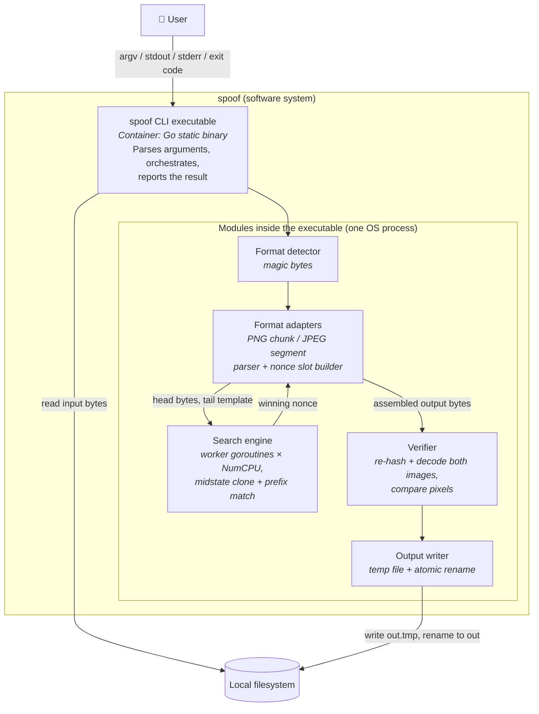

---
blueprint:
  type: c4-container
  id: art_c4-container
  version: 1
  status: in_review
  inputs:
    artifacts:
      - { id: art_c4-context, version: 1 }
  evidence:
    - "README.md line 2: one input (image + hexstring) and one output (adjusted file), which fits a single-process CLI"
    - "git ls-files: no Dockerfile, service config or deployment manifest exists, so nothing suggests more than one deployable"
  guesses:
    - "One statically linked Go executable (see ADR-0001, Q-07)"
    - "The nonce search runs on in-process worker goroutines, one per CPU core, not on GPUs or remote workers (see Q-06)"
    - "Format support is split into pluggable PNG and JPEG adapters (see ADR-0002, Q-03)"
---

# spoof: Containers (C4 level 2)

## Containers and responsibilities

| Container / module | Technology (guess) | Responsibility | Talks to |
|---|---|---|---|
| **spoof CLI executable** (the only deployable) | Go 1.2x, static binary | Validates the hexstring and paths, loads the input, runs the pipeline, prints the digest or an error, sets the exit code | User (process I/O), filesystem |
| Format detector | Go stdlib | Picks the adapter from the magic bytes and rejects unknown formats (R-08, R-09) | Format adapters |
| Format adapters (PNG, JPEG) | Go stdlib (`encoding/binary`, `hash/crc32`) | Parses blocks with bounds checks, chooses where the nonce goes, builds the head/tail bytes, encodes the nonce (incl. the PNG chunk CRC) | Search engine, verifier |
| Search engine | Go `crypto/sha512`, goroutines, `context` cancel | Hashes the head once into a midstate. Each worker clones it, hashes nonce + tail, and checks the prefix. Stops all workers on the first hit or on timeout (R-13, R-14) | Format adapters |
| Verifier | Go `image/png`, `image/jpeg` | Checks the full-file digest has the prefix and that decoded pixels match the source (R-15) | Output writer |
| Output writer | Go `os` | Refuses to write over the input, writes to a temp file in the target directory, then renames (R-10, R-19) | Filesystem |

## Notes

- There is a single runtime container. Its parts talk through in-process function calls and channels. There is no IPC, network or persistence beyond the two files.
- Parallelism lives inside the one process. Workers search disjoint nonce ranges (e.g. worker *k* tries `k, k+N, k+2N, …`), so no shared state is needed beyond a cancel signal and a result channel.
