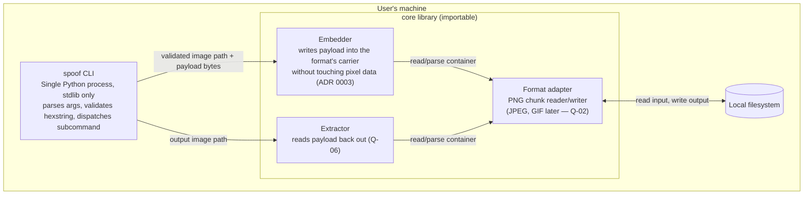

---
blueprint:
  type: c4-container
  id: art_c4-container
  version: 1
  status: in_review
  inputs:
    artifacts:
      - { id: art_c4-context, version: 1 }
  evidence:
    - "README.md:2 — a single input-to-output transformation, implying a single-process tool with no separate deployable parts"
  guesses:
    - "The runtime is a Python 3 process, stdlib only (see Q-04, ADR 0001)"
    - "The internal module split below is the natural shape for this pipeline; no code exists yet to confirm it"
---

# C4 containers — spoof

## Containers and responsibilities

| Container / component | Kind | Responsibility |
|---|---|---|
| **spoof CLI** | Executable (single Python process) | Argument parsing, hexstring validation (R-08), format detection (R-09), error reporting (N-06); the only entry point |
| ↳ Format adapter | In-process module | Parse and rewrite the image container (PNG chunks; JPEG/GIF deferred, Q-02) while leaving pixel data byte-identical |
| ↳ Embedder | In-process module | Write the payload bytes into the carrier and write the output file (R-03, R-05) |
| ↳ Extractor | In-process module | Read the payload back out for verification/round-trip (R-06, Q-06) |
| **Local filesystem** | External data store | Holds the input image (read-only) and the output image (write-once) |

## Notes

- There is exactly **one runtime container**: a single-process CLI with no server, daemon, or network listener. The core is kept importable so the CLI is a thin shell over the library **(guessed, Q-05)**.
- The format adapter is the only place that knows container details; adding JPEG or GIF support must not change the embedder/extractor contracts (see ADR 0002).
- The filesystem is the only I/O boundary; everything between reading and writing is pure byte transformation, which makes the round-trip property (N-07) testable without any file system.
