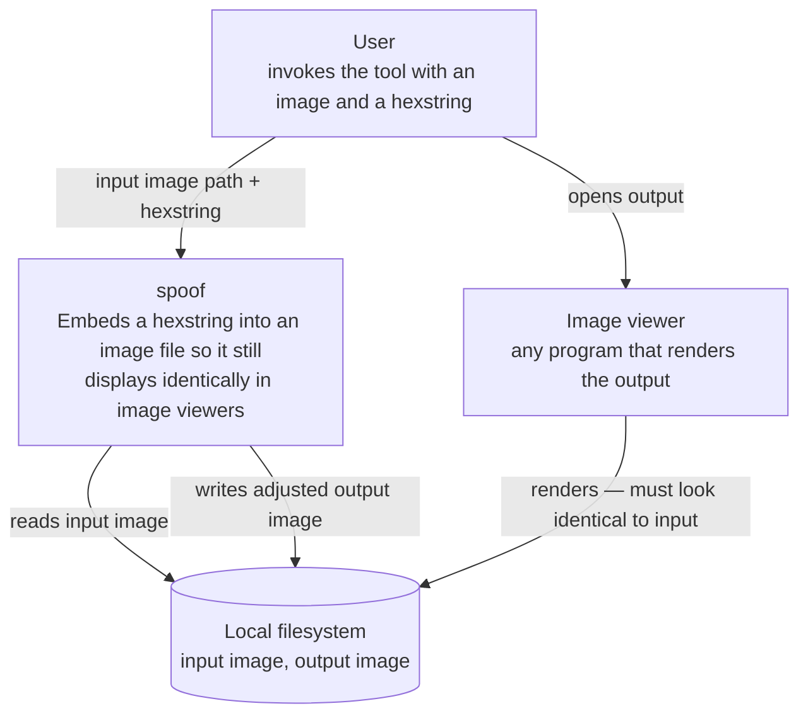

---
blueprint:
  type: c4-context
  id: art_c4-context
  version: 1
  status: in_review
  inputs:
    artifacts:
      - { id: art_requirements, version: 1 }
  evidence:
    - "README.md:2 — the system boundary is the one operation described: image + hexstring in, adjusted file out"
    - "README.md:2 — 'when opened in image viewers' names the downstream consumer that judges correctness"
  guesses:
    - "The user is a single person at a terminal invoking a CLI (see Q-05)"
    - "The tool is offline and touches no network services (see Q-09)"
---

# C4 context — spoof

## Notes

- **System (spoof).** The entire system is one operation: take an image and an arbitrary hexstring, emit an adjusted file that renders identically to the original in image viewers (README.md:2).
- **User.** A person at a command line **(guessed, Q-05)**. No authentication, roles or multi-user concerns exist — the tool is a personal utility.
- **Local filesystem.** The only external system the tool talks to: it reads the input image and writes the output image there. The input is never modified (R-07 **guessed**).
- **Image viewer.** Not a system *spoof* communicates with, but its judge: R-04 ("displays identically to the human eye") is defined from the viewer's perspective. The tool must satisfy every reasonable viewer, which is why the design favors carriers that leave pixel data untouched (ADR 0003).
- **Deliberately absent.** No network services, databases, or other integrations are described in the README; none are assumed **(Q-09)**.
