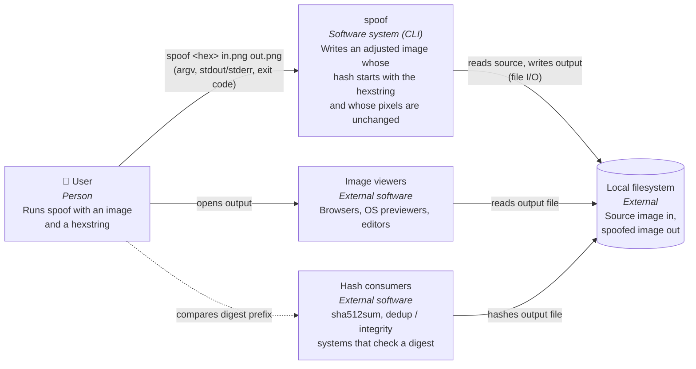

---
blueprint:
  type: c4-context
  id: art_c4-context
  version: 1
  status: in_review
  inputs:
    artifacts:
      - { id: art_requirements, version: 1 }
  evidence:
    - "README.md line 2: the actors and neighbours named: a user supplying 'an image and an arbitrary hexstring', an output file, and 'image viewers'"
    - "README.md: no server, network service, database or third-party API is mentioned"
  guesses:
    - "spoof is a local command-line tool with no network dependencies (see Q-07)"
    - "The output's hash is checked by some external hash tool or system that only looks at a hex prefix (see Q-01, Q-02)"
---

# spoof: System context (C4 level 1)

## Notes

- **The system boundary is one local process.** The README mentions no server, network, account or storage beyond the image files themselves.
- **Image viewers do not talk to spoof.** They are the acceptance oracle: the output must render exactly like the input in them (R-04).
- **Hash consumers** (guessed, Q-01) are whatever checks the digest prefix. The README cut-off leaves their identity and the algorithm unknown (Q-02).
- Trust boundary: the input image is **untrusted data**, because it may come from anywhere. The user and the local filesystem are trusted. See `nfr-and-threats.md`.
