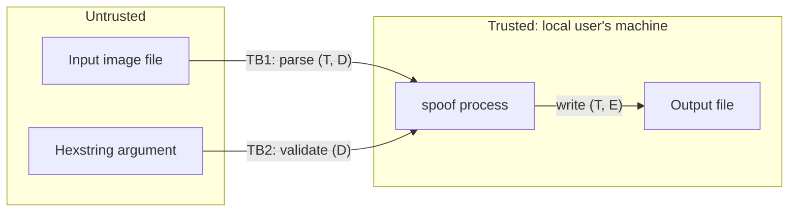

---
blueprint:
  type: nfr
  id: art_nfr-and-threats
  version: 1
  status: in_review
  inputs:
    artifacts:
      - { id: art_c4-container, version: 1 }
  evidence:
    - "README.md line 2: the only specification, a sentence fragment that leaves the hexstring's role unstated"
    - "git ls-files: the repository holds only README.md (no code, tests, licence or CI), so all characteristics below are design targets, not observed behaviour"
  guesses:
    - "The target is a SHA-512 prefix of the whole output file (see Q-01, Q-02)"
    - "Realistic prefixes are 8 hex digits or fewer (see Q-06)"
    - "Existing metadata is preserved (see Q-08)"
---

# spoof: Non-functional characteristics and threats

## Non-functional characteristics (targets)

| Area | Target | Notes |
|---|---|---|
| Performance | O(1) work per attempt, independent of image size; uses every core | Midstate reuse (ADR-0003). Expected attempts 16^n: 4 digits are instant, 6 take about 1 s, 8 take a few minutes, 10 take hours, 12+ are impractical on a CPU |
| Bounded runtime | `--timeout` and a maximum prefix length; clean exit code 3 | The search is probabilistic and has no hard upper bound (R-14) |
| Memory | About the file size × 2 (source + output). Input capped, e.g. 256 MiB | Decoding to verify can use far more memory than the file size, so cap pixel dimensions too |
| Correctness | Every output is re-hashed and pixel-compared before it is written | R-15. Guards against adapter bugs |
| Fidelity | Decoded pixels are bit-identical; metadata preserved; size grows by < 64 B | R-04, R-12 |
| Portability | Static binaries for linux/darwin/windows × amd64/arm64 | ADR-0001 |
| Reliability | Atomic write (temp file + rename); refuses to overwrite the input; partial output never left behind | R-19 |
| Usability | Clear errors for bad hex, unsupported format, or timeout; digest printed on success | R-09, R-11 |
| Privacy | Offline; nonce holds only a counter, no host or user data | R-17 |
| Determinism | Not guaranteed with parallel workers | Q-09. A single-worker or "lowest nonce wins" mode could provide it |

## STRIDE-lite threats

| # | STRIDE | Threat / risk | Mitigation |
|---|---|---|---|
| T-01 | Spoofing | **Misuse of the tool's purpose:** the output can trick systems that identify files by a *short hash prefix* (truncated IDs in UIs, prefix-based "proof" schemes, naive dedup). | Document that full-length digests are unaffected. Producing a full SHA-512 match is computationally infeasible. Keep prefix limits sensible. |
| T-02 | Tampering | A malicious input with huge or negative chunk/segment lengths, truncated data, or invalid CRCs could cause out-of-bounds reads or panics in the parser. | Bounds-checked parsing, length sanity limits, refusing trailing junk/overlaps, fuzz tests for each adapter. |
| T-03 | Tampering | Output path tricks: a symlink at the output path, output == input, or writing into an unexpected directory. | Resolve and compare the real paths; create the temp file with `O_EXCL`; never follow a symlink for the temp file; refuse to overwrite without `--force`. |
| T-04 | Repudiation | Hard to tell later that a file was altered by spoof. | Use a recognisable block (e.g. PNG `spOf` chunk, COM text `spoof:<nonce>`) so altered files can be identified. Q-08 decides whether this is wanted. |
| T-05 | Information disclosure | EXIF metadata such as GPS location or camera serial is kept in the output, which the user may then share. | Keep metadata by default (fidelity), but document this and consider a `--strip-metadata` option (Q-08). |
| T-06 | Denial of service | A long hexstring (e.g. 128 digits) makes the search effectively endless and pins every core. | Maximum prefix length, a warning above about 10 digits, a default timeout, and Ctrl-C handling that stops workers promptly. |
| T-07 | Denial of service | Decompression bombs: a small file declaring enormous dimensions exhausts memory during verification. | Check the declared width × height against a limit before decoding. Cap the input file size. |
| T-08 | Elevation of privilege | None identified. The tool runs locally with the user's own rights, has no network surface, and runs no input-derived code. | Keep the dependency set to the stdlib (ADR-0001) to limit supply-chain exposure. |

## Risks and gaps noticed in the repository

| # | Finding |
|---|---|
| G-01 | **The specification is incomplete.** `README.md` line 2 is a sentence fragment with a leading space: "An image and an arbitrary hexstring and outputs…". It never says what the hexstring is for. The whole design rests on the hash-prefix reading (Q-01, blocking) and an assumed algorithm (Q-02, blocking). |
| G-02 | No licence file, so the reuse terms for the project are undefined. |
| G-03 | No tests, CI or build config yet. Golden-file tests (known input + prefix → digest prefix + identical pixels) and parser fuzzing should come with the first code. |
| G-04 | The late JPEG `COM` placement is tolerated by mainstream decoders, but strict validators may warn about it (Q-10). The ADR-0003 fallback covers this at the cost of slower attempts. |
| G-05 | Running spoof on its own output stacks nonce blocks unless the adapter detects and replaces an existing spoof block. |
