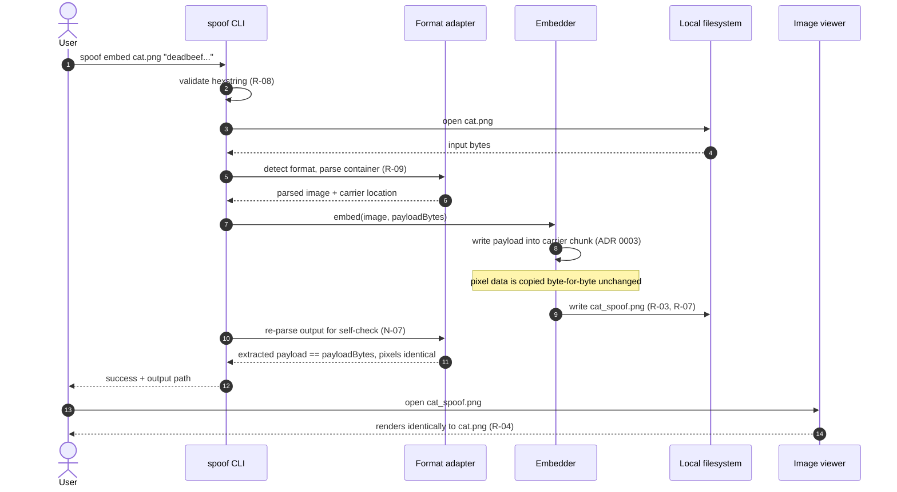

---
blueprint:
  type: sequence
  id: art_seq-embed-hexstring
  version: 1
  status: in_review
  inputs:
    artifacts:
      - { id: art_c4-container, version: 1 }
  evidence:
    - "README.md:2 — the main flow is literally the tool's one-line description: image + hexstring in, adjusted file out"
  guesses:
    - "A metadata-style carrier (e.g. PNG ancillary chunk) is used, so pixel bytes are copied verbatim (see Q-03, ADR 0003)"
    - "An extraction step exists to verify the round-trip (see Q-06)"
---

# Main flow — embedding a hexstring into an image

## Notes

- This is the whole system: steps 1–11 are the tool's only job. The self-check at steps 10–11 (embed, then re-extract and compare) is what makes the visual-identity claim verifiable without a human **(guessed, Q-06)**.
- The critical invariant is the note at step 8: the pixel data reaches the output **byte-identical** because the payload travels in a carrier that no viewer renders (ADR 0003). "Displays identically" then holds by construction rather than by visual approximation (N-01).
- The input file is only ever opened for reading; the result goes to a new path (R-07 **guessed**, Q-08).
- Failure paths fall out of the same sequence: invalid hexstring fails at step 2, an unsupported/corrupt image at step 6, and an oversized payload at step 8 (R-10) — all with a non-zero exit and no output file written (N-06).
