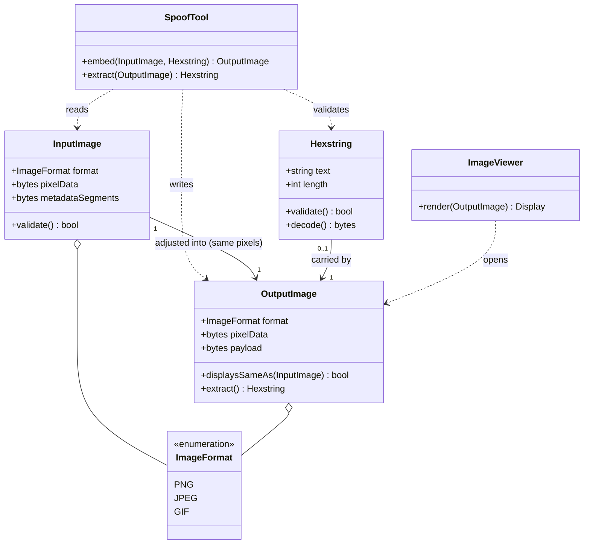

---
blueprint:
  type: domain
  id: art_domain
  version: 1
  status: in_review
  inputs:
    artifacts:
      - { id: art_requirements, version: 1 }
  evidence:
    - "README.md:2 — the entities 'an image', 'an arbitrary hexstring' and 'an adjusted file' appear verbatim in the description"
  guesses:
    - "The hexstring is a payload that is embedded and recoverable, not just appended and forgotten (see Q-01)"
    - "'Adjusted file' means an image of the same format whose displayed pixels are unchanged (see Q-03)"
---

# Domain model for spoof

## Glossary

- **Image** — the input picture file the user supplies (README.md:2, "An image").
- **Hexstring** — an arbitrary-length string of hexadecimal characters `[0-9a-fA-F]`, interpreted as raw bytes (README.md:2, "an arbitrary hexstring"). Also called the **payload**.
- **Adjusted file / output image** — a new image file, of the same format as the input, that carries the payload while rendering identically to the input (README.md:2, "outputs an adjusted file").
- **Payload** — the hexstring once embedded in the output image. Recoverable by extraction **(guessed, Q-01)**.
- **Carrier** — the part of an image file that can hold the payload without affecting rendering: a lossless metadata region such as a PNG ancillary chunk, a JPEG comment/APP segment, or least-significant pixel bits **(guessed, Q-03)**.
- **Image format** — the on-disk encoding of the image (PNG, JPEG, GIF, …). Which are supported is undecided **(Q-02)**.
- **Image viewer** — any program that opens and renders the file; the arbiter of R-04/N-01 (README.md:2, "when opened in image viewers").
- **Embedding** — the act of writing the payload into the carrier, producing the output image.
- **Extraction** — the inverse operation, reading the payload back out of an output image **(guessed, Q-06)**.
- **Round-trip** — the property that `extract(embed(image, h)) == h` and the embedded image's pixels equal the original's.

## Notes

- The central domain relationship is the triangle *InputImage → OutputImage ← Hexstring*: the output is simultaneously a faithful copy of the image and a container for the hexstring.
- `displaysSameAs` is the key invariant of the system (R-04, N-01): it must hold by construction of the carrier, not by luck.
- `ImageFormat` is drawn as an enumeration of candidates, not a commitment; PNG-first is the working assumption **(Q-02)**.
