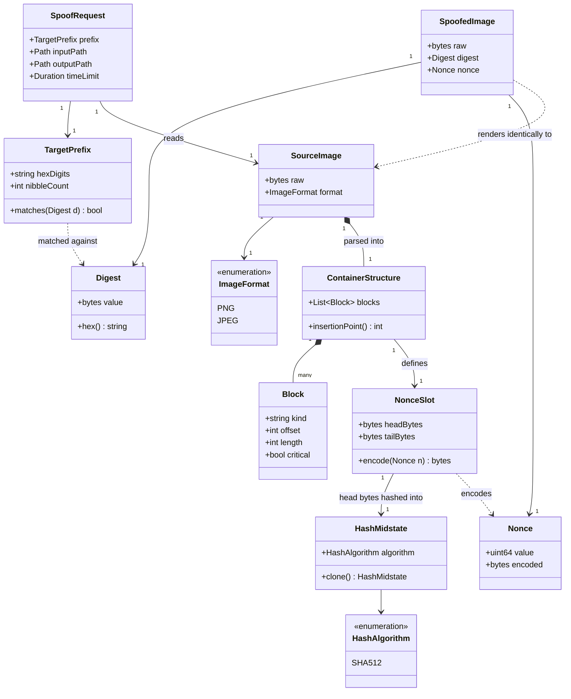

---
blueprint:
  type: domain
  id: art_domain
  version: 1
  status: in_review
  inputs:
    artifacts:
      - { id: art_requirements, version: 1 }
  evidence:
    - "README.md line 2: names the core concepts: image, arbitrary hexstring, adjusted (output) file, 'displays identically', image viewers"
  guesses:
    - "TargetPrefix is matched against a SHA-512 digest of the whole output file (see Q-01, Q-02)"
    - "The adjustment is a nonce placed in an ignorable metadata container (PNG ancillary chunk / JPEG COM segment), not a pixel change (see Q-04, Q-08)"
    - "Only PNG and JPEG are modelled as ImageFormat values (see Q-03)"
---

# spoof: Domain model

## Glossary

| Term | Meaning |
|------|---------|
| **Source image** | The input image file the user supplies (README: "An image"). It is never modified. |
| **Hexstring / Target prefix** | The "arbitrary hexstring" from the README. *Guess:* the leading hex digits the output file's hash must start with. Normalised to lower case with any `0x` removed. Its length in nibbles sets the difficulty. |
| **Spoofed image / Output file** | The "adjusted file" the tool writes. Viewers render it exactly like the source image, but its bytes differ. |
| **Displays identically** | *Guess:* the output decodes to exactly the same pixel buffer (dimensions, colour type, samples) as the source. This is stricter than "looks the same". |
| **Image format** | The file container type (PNG, JPEG), found from the magic bytes: `89 50 4E 47 0D 0A 1A 0A` for PNG, `FF D8 FF` for JPEG. |
| **Container structure** | The parsed list of blocks in the file. PNG files have chunks (length, type, data, CRC). JPEG files have marker segments. |
| **Block** | One PNG chunk or JPEG segment. A *critical* block affects decoding (IHDR, IDAT, SOF, SOS…). An *ancillary* block can be ignored by viewers (tEXt, COM…). |
| **Nonce slot** | The ancillary block that spoof adds to hold the varying payload: a private PNG ancillary chunk placed just before `IEND`, or a JPEG `COM` segment. It is split into *head bytes* (everything before the nonce) and *tail bytes* (anything after it, e.g. PNG CRC + `IEND`). |
| **Nonce** | The counter value written into the slot. Changing it changes the file hash but not the pixels. |
| **Hash midstate** | The hash state after absorbing the head bytes. Each attempt clones it, so only the nonce and tail are hashed again. |
| **Digest** | The hash of the full output file, shown in hex. |
| **Attempt** | One nonce tried: encode the nonce, finish the hash, and compare against the target prefix. Expected attempts = 16^n for an n-nibble prefix. |
| **Image viewer** | Any ordinary program that renders images (browsers, OS previewers, editors). It is the acceptance oracle for "displays identically". |
